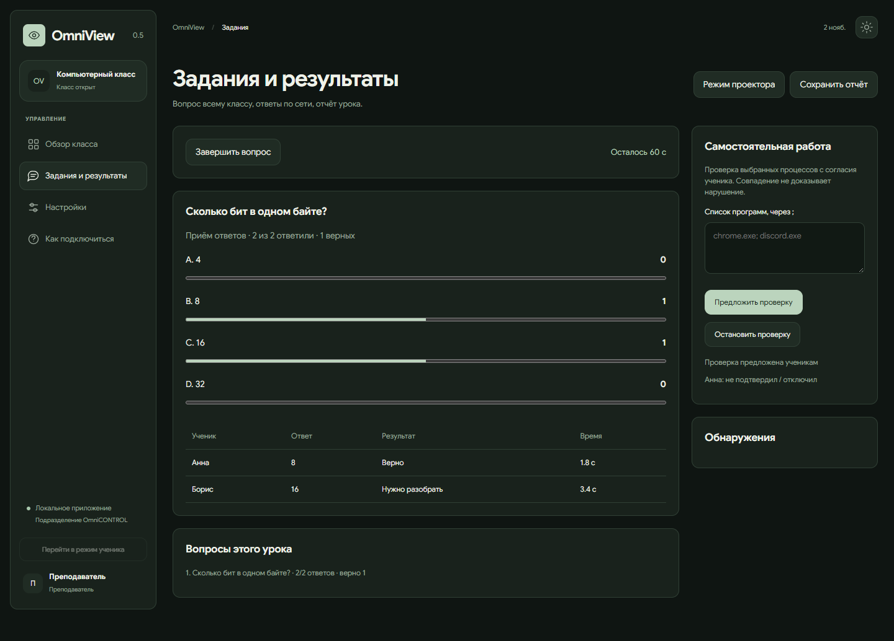
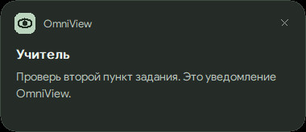

# OmniView

**OmniView — подразделение OmniCONTROL.** Программа для компьютерного класса: экраны, сообщения, задания и результаты урока в локальной сети.

[Загрузки](https://github.com/velmourcnikita/OmniView/releases) · [Проверки сборок](https://github.com/velmourcnikita/OmniView/actions) · [Сценарий защиты](docs/competition.md)

[](https://github.com/velmourcnikita/OmniView/actions/workflows/verify.yml)



Скриншот показывает реальный интерфейс с подготовленными данными. Это не результаты испытаний в школе.

Уведомления появляются в отдельной карточке программы, в том числе поверх других окон:



## Возможности версии 0.5

- Участники класса, поиск, фильтры, запросы помощи и сообщения в обе стороны.
- Просмотр экрана ученика после включения им показа; показ экрана учителя и полноэкранный просмотр у ученика.
- Управление мышью и клавиатурой после отдельного разрешения ученика; остановка по Esc.
- Вопросы с 2–6 вариантами, таймер, один ответ от ученика, раскрытие правильного ответа после завершения.
- Распределение ответов, режим проектора без имён, банк до 30 вопросов и печатный отчёт HTML.
- Проверка списка до 20 запрещённых процессов на самостоятельной работе, с явным согласием ученика. Обнаружения видны в журнале.
- Собственные уведомления в правом нижнем углу рабочего стола. Время в настройках: 5–60 секунд, по умолчанию 9. Новые обычные уведомления ждут в очереди.
- Приглашения OV3, защищённые отдельным паролем; настройки, темы и отключаемые анимации.
- Сборки Windows x86 и x64.

## Запуск

Нужны Windows 10 x86/x64 или Windows 11 x64 и [Microsoft Edge WebView2 Runtime](https://developer.microsoft.com/microsoft-edge/webview2/). Интернет и аккаунт для работы класса не требуются.

1. Распакуй соответствующий архив целиком. Не смешивай EXE и DLL из x86 и x64.
2. Учитель запускает `OmniView.exe`, задаёт пароль от восьми символов и нажимает «Открыть класс».
3. Ученик запускает `OmniView-Student.exe`, вводит имя, код OV3 и пароль.
4. Показ экрана и проверка программ включаются отдельно на компьютере ученика.
5. Для задания открой «Задания и результаты», введи вопрос, варианты, правильный вариант и время.
6. Заверши приём ответов и сохрани отчёт. Путь отображается в настройках.

Компьютеры должны быть в одной локальной сети. При запросе брандмауэра разреши свою частную сеть. Если есть VPN или несколько адаптеров, проверь IPv4 учителя в настройках. После завершения класса приглашение больше не действует.

## Экран и слабые компьютеры

По умолчанию включён экономный режим: до 640 px раз в пять секунд. В обычном режиме — до 1280 px, целевая частота до четырёх кадров/с, без звука. Фактическая частота зависит от захвата, кодирования и сети. Это передача JPEG-кадров, не видеокодек. Для большого класса начни с экономного режима.

Изображения загружаются отдельно от JSON-состояния; большие строки разделяются через Arc, карточки не пересоздаются при каждом опросе. Уведомления используют GDI и не запускают второй WebView. Нет фоновой службы или автозапуска.

На старом оборудовании, на настоящей 32-битной Windows и в полном школьном классе испытания ещё нужны. x86 под WoW64 не заменяет проверку на x86 ОС. Windows 7/8 не поддерживаются.

## Удалённая помощь

Ученик включает показ экрана, учитель открывает его карточку и нажимает «Запросить управление». Ученик отдельно нажимает «Разрешить на 5 минут». Нажатия, перетаскивание, правый клик, прокрутка, текст и сочетания клавиш передаются через защищённое соединение. Для клавиатуры нужно нажать на изображение экрана; для текста есть отдельное поле.

Esc на компьютере ученика, кнопка остановки, нажатие на постоянную карточку уведомления или выключение показа немедленно отзывают местное разрешение. Потеря контакта более двух секунд тоже закрывает ввод. Закрытие карточки ученика у учителя завершает сеанс. Продление требует нового согласия. Во время управления показ временно переходит в обычный режим; нагрузка возрастает.

Поддерживается основной монитор. Защищённый рабочий стол Windows и окна с более высокими правами не поддерживаются. Задержка зависит от компьютера и сети.

## Приглашения и проверка процессов

OV3 — собственный формат конверта с AES-256-GCM и PBKDF2-HMAC-SHA256 (210 000 итераций). Соль и nonce создаются заново; пароль не включается в код. Hex используется для передачи зашифрованных байтов. Base64-кодирование старого OV2 сохранено только для совместимости. Сетевой транспорт использует TLS с сертификатом из приглашения. Передавай код и пароль раздельно.

При проверке процессов ученик видит список и подтверждает участие. Передаются только совпавшие имена `.exe`, время и состояние проверки. Изменение списка отзывает согласие. Проверка останавливается при отключении; остальной список процессов, пути и заголовки окон не передаются.

Сопоставление идёт по точному имени процесса. Переименование и другие обходы не исключены. Факт обнаружения не доказывает нарушение, отсутствие события не гарантирует отсутствие запрещённого ПО. Автоматического завершения процессов нет.

## Данные

- `%LOCALAPPDATA%\OmniView\settings.json` — настройки.
- `%LOCALAPPDATA%\OmniView\exports\` — JSON и HTML-отчёты.
- Банк вопросов хранится в локальном профиле интерфейса.
- Кадры не сохраняются на диск. Отчёты могут содержать имена учеников; передавай их только адресатам.
- Один класс — до 40 участников и 30 вопросов за сеанс.

## Сборка

Нужны Rust и LLVM-MinGW с windres для ресурсов EXE. Локальные цели: `x86_64-pc-windows-gnu` и `i686-pc-windows-gnullvm`. CI проверяет MSVC x64/x86 на Windows.

```powershell
cargo fmt --check
cargo test --locked
./scripts/package.ps1 -Architecture x64
rustup target add i686-pc-windows-gnullvm
cargo test --locked --target i686-pc-windows-gnullvm
./scripts/package.ps1 -Architecture x86
./scripts/verify-release.ps1 -Directory dist
./scripts/verify-release.ps1 -Directory dist/win32
```

`OmniView.exe --self-test` проверяет TLS, зашифрованное приглашение, реальные рабочие потоки учителя и ученика на 127.0.0.1, вопросы, подтверждение ответа, проверку собственного тестового процесса, отзыв согласия и показ собственного экрана. Снимки остаются в памяти. Результат записывается в `%LOCALAPPDATA%\OmniView\self-test.json`. Это тест на одном ПК.

`--control-test` проверяет настоящий ввод только в собственном тестовом окне на переднем плане: мышь, клик, Unicode и Backspace. Результат — `control-smoke.json` в папке данных программы.

`--ui-smoke` проверяет настоящий WebView и IPC. `scripts/check-ui.cjs` отдельно проверяет интерфейс с тестовым IPC. Инструкции для запуска находятся в начале скрипта.

## Проверка происхождения релиза

`manifest.json` содержит SHA-256, размер, архитектуру и версию файлов. Проверка: `scripts/verify-release.ps1`. Манифест надо получать из доверенного комплекта: один только хеш не удостоверяет издателя.

Workflow создаёт Windows-архивы и статический сайт. При отправке тега `v*` он формирует attestation и черновик GitHub Release. До успешного запуска нельзя считать сборку подтверждённой GitHub.

```powershell
gh attestation verify OmniView-0.5.0-win64.zip --repo velmourcnikita/OmniView
```

Сведения «Компания: OmniCONTROL» записаны в свойства EXE. Это метаданные, не цифровая подпись Authenticode.

## Сайт

```powershell
cd site
npm ci
npm run dev
npm run build
```

Результат — `site/.vitepress/dist/`. Интерактивный пример вопросов работает только в браузере и не выдаётся за живую трансляцию. Для размещения в подпапке задай переменную `SITE_BASE`, например `/OmniView/`.

## Устройство проекта

`src/classroom.rs` — TLS и обмен; `lesson.rs` — задания; `assessment.rs` — проверка процессов; `invitation.rs` — шифрование; `control.rs` — согласие и ввод; `capture.rs` — захват экрана; `notifications.rs` — собственные уведомления; `app.rs` — команды и состояние. Интерфейс — `web/`, сайт — `site/`.

Передача звука, блокировка и выключение чужого компьютера отсутствуют. Код не следует описывать как полную замену Veyon.

Шрифт поставляется по SIL Open Font License; текст лицензии — `assets/fonts/OFL.txt`. Старые варианты и презентация 0.3 сохранены в полном комплекте отдельно от текущих исходников.
